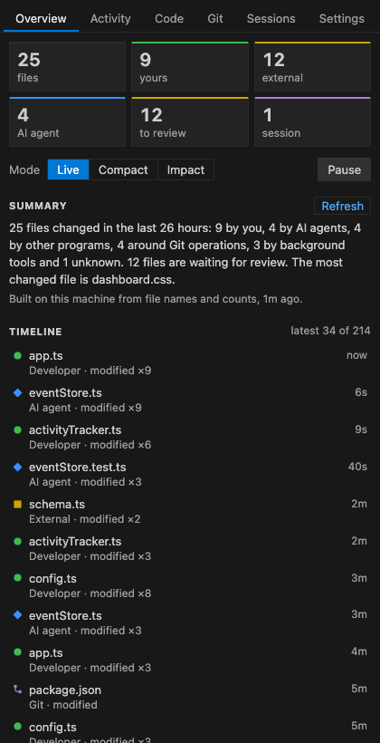
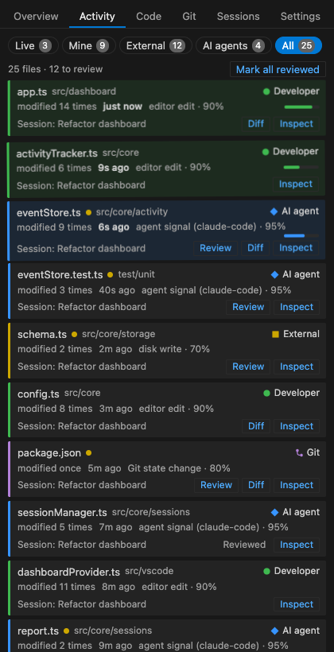
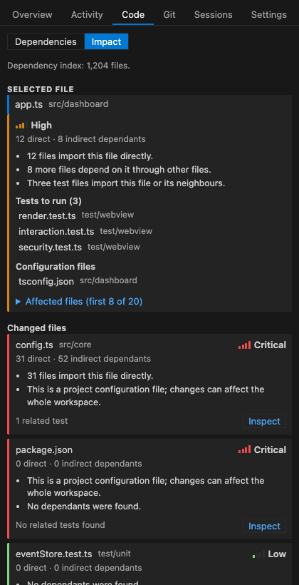
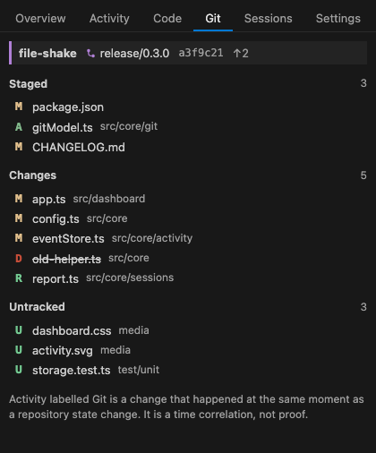

# File Shake

Real-time developer activity intelligence for VS Code. Track file changes, understand external and AI-assisted modifications, explore dependencies and monitor your codebase.

File Shake watches which files change, whether **you are typing** in them or **something else** (a tool, git, a formatter, an agent) is writing them, and shows it live. It has two ways to look at the same activity:

- **Live Mode, the original experience.** A "File Shake" tree in the Explorer sidebar. The file being edited is **green** and **shakes** in proportion to how fast it changes; the files it references (imports, requires, includes) are **yellow** and shake in proportion to how often they are referenced. Rows stay until whoever changed them moves on.
- **The activity dashboard (new in 0.3.0).** A "File Shake" icon in the Activity Bar opens a dashboard with an overview, a history of changes by source, dependencies and an impact estimate, Git changes, development sessions and settings.

Everything is configurable (`fileShake.*`), respects reduced motion, and works in light, dark and high-contrast themes.

This README describes what exists. Where File Shake cannot know something, it says so; see "What it can and cannot do" first.

## Contents

- [Install](#install)
- [The dashboard](#the-dashboard)
- [Where a change comes from: source classes](#where-a-change-comes-from-source-classes)
- [What it can and cannot do](#what-it-can-and-cannot-do-please-read)
- [Live Mode: who is who, and how long rows stay](#live-mode-who-is-who-and-how-long-rows-stay)
- [How "you" versus "external" is decided](#how-you-versus-external-is-decided)
- [How references, dependencies and impact work](#how-references-dependencies-and-impact-work)
- [Sessions, Git, collisions and pause](#sessions-git-collisions-and-pause)
- [AI-assisted mode: what it does and does not do](#ai-assisted-mode-what-it-does-and-does-not-do)
- [Experimental: the agent signal file](#experimental-the-agent-signal-file)
- [Commands](#commands) and [Settings](#settings)
- [Privacy](#privacy)
- [Troubleshooting](#troubleshooting)

## Install

File Shake is not on the Marketplace yet, so you install it from a `.vsix` file that you build once. You need VS Code 1.85 or newer, plus Node.js and npm to build it (CI uses Node 22; development was done on Node 24).

**1. Build the package**

```bash
git clone https://github.com/AblorhSowah/file-shake.git
cd file-shake
npm ci
npm run package
```

This creates `file-shake-0.3.0.vsix` (about 110 KB) in the project folder.

**2. Install it**

From a terminal:

```bash
code --install-extension file-shake-0.3.0.vsix
```

If the `code` command is not found, open the Command Palette in VS Code and run **Shell Command: Install 'code' command in PATH**, then try again.

Or from inside VS Code: open the Extensions view, click the `...` menu at the top, choose **Install from VSIX...**, and pick the file.

**3. Reload and look for it**

Run **Developer: Reload Window**, open a project folder, and look for two things: the **File Shake** icon in the Activity Bar (the dashboard) and the **File Shake** view in the Explorer sidebar (Live Mode). Start typing in a file and it turns green and shakes; the files it imports turn yellow.

**Update:** pull the latest code, then run `npm ci`, `npm run package` and the install command again, and reload the window.

**Uninstall:** `code --uninstall-extension file-shake.file-shake`, or use the Extensions view.

## The dashboard

Open it from the File Shake icon in the Activity Bar, with `File Shake: Open Dashboard`, or in an editor tab with `File Shake: Open Dashboard in Editor`. It is designed for a narrow sidebar and for the keyboard (the tabs follow the standard arrow, Home and End keys).

| Tab | What it shows |
|---|---|
| **Overview** | Counts of modified files, your changes, external changes, AI agent changes, changes to review and active sessions; the mode switch and pause; a summary; a timeline of the latest changes |
| **Activity** | One list of files with filter chips: Live, Mine, External, AI agents, All. Each row shows the source, the detection method, how often it changed, and an intensity meter. Rows can be marked reviewed, opened, or inspected |
| **Code** | **Dependencies**: what the selected file imports and who imports it. **Impact**: an estimate of what a change to it can affect, with the reasons and related test files |
| **Git** | Per repository: branch, commit, ahead and behind, and the staged, changed and untracked files, with "open diff" |
| **Sessions** | Start, stop and rename a session, export its report, and see previous sessions |
| **Settings** | Mode, animation, pause, history (with a clear button), what the AI mode does and what it would send, and a button for all settings |

The pictures below are the real dashboard rendered with **sample data** (file names, counts and the agent name are made up, and the wording of the impact reasons is illustrative, not what the extension writes for your files).






Every state says what is true: "No activity yet", "Tracking is paused", "File Shake is off", "Git is not available" (with the reason), "Indexing dependencies: 340 of 1,200 files", and, for AI agents, "No agent adapter is reporting. Changes made by agents appear under External."

### Modes

Choose with `File Shake: Set View Mode`, the dashboard, or `fileShake.viewMode`.

| Mode | What changes |
|---|---|
| `live` (default) | Rows shake with activity, as in the original Explorer view |
| `compact` | Calm single-line rows with no meters and no shaking. Also stops the shaking in the Explorer view |
| `impact` | Each row shows an impact level badge and the number of dependants; the Code tab opens on Impact. Needs the dependency index (see below) |

`fileShake.animationIntensity` (0.25 to 2) scales how far and how much rows shake, in the dashboard and in the Explorer view. Reduced motion (the OS setting) and `fileShake.enableAnimation` turn shaking off completely in every mode; colour, labels and the intensity meter remain, so nothing depends on motion or on colour alone. Each source has its own icon shape and a text label.

## Where a change comes from: source classes

Every recorded change gets one of six source classes, a detection method, and a confidence from 0 to 1. The confidence is how sure the rule is, not a measured probability.

| Class | How File Shake decides | Method | Confidence |
|---|---|---|---|
| **Developer** | You typed, pasted or used multi-cursor in the focused editor of a focused window | `focused-editor-edit` | 0.9 |
| | Undo or redo | `undo-redo` | 0.95 |
| | You created or deleted a file through VS Code (Explorer, a command) | `workbench-file-operation` | 0.95 |
| **AI agent** | An adapter reported that an agent wrote that file within 3 seconds of the change: the experimental signal file, or another extension calling `reportAgentActivity` | `agent-signal` | 0.95 |
| **Git** | A change to a file inside a repository whose branch or commit changed within 3 seconds (checkout, pull, commit). A time correlation, not proof | `git-state-change` | 0.8 |
| **External** | The file changed on disk and nothing else explains it | `disk-write` | 0.7 |
| | An open, unmodified document was reloaded from disk | `reload-from-disk` | 0.7 |
| | The file was deleted on disk | `disk-delete` | 0.7 |
| **Automated** | A document that is not the focused editor changed while it had unsaved edits: a refactor, a rename, another extension applying an edit | `workspace-edit` | 0.6 |
| **Unknown** | Nothing above fits (for example a restored record) | `restored` | 0.2 |

An `AI agent` or `Git` label replaces `External` or `Automated` only; it never re-labels something you typed. If an adapter report arrives a moment after the change, the recent change is re-labelled. Without a report, an agent's writes are shown as **External**.

## What it can and cannot do (please read)

These are limits of the VS Code extension API and of static analysis, not bugs. File Shake is built around them instead of pretending otherwise.

1. **The native Explorer tree cannot shake.** VS Code lets extensions decorate Explorer rows only with a colour, a badge and a tooltip; there is no way to animate or restyle them. So File Shake has two layers:
   - **Native Explorer layer**: edited files are tinted green, referenced files yellow, with a short badge and tooltip (and, optionally, their parent folders are tinted too). No motion.
   - **Live "File Shake" view** (a webview in the Explorer sidebar) and the dashboard: this is where the shaking happens.
2. **The native badge cannot say `typing`, `external` or `×N refs`.** Explorer badges are limited to 1-2 characters (a two-character badge limit). Natively you get `●` (edited by you), `◆` (changed externally) and the reference count `1`..`9` / `9+` for referenced files. The words appear in the views and in tooltips.
3. **Colours.** Native decorations can only use contributed theme colours, so to change the Explorer colours override `fileShake.editedForeground` and `fileShake.referencedForeground` in `workbench.colorCustomizations`. The settings `fileShake.colors.edited` / `fileShake.colors.referenced` (empty = follow the theme) change **the File Shake view only** (webview only). Defaults: green `#3fb950`, yellow `#e3b341` (darker tones in light themes for contrast).
4. **File Shake cannot identify who wrote a file.** VS Code gives extensions no writer identity. File Shake can tell *typing in the focused editor* (`you`) from *any other change* (`external`): git, formatters, code generators, build tools, other extensions, sync clients, and agents. A change is labelled `AI agent` only when an adapter reported it. There is **no Claude, Copilot or Cursor integration**, and File Shake does not detect any of them.
5. **Reference counts and dependency edges are heuristic.** They are found with a fast token scan (regex based, not an AST, not a type checker or language server), so shadowed names, same-package references in Go and Java, bundler aliases and package `exports` are not understood.
6. **Yellow only follows files that were changed.** Yellow rows exist for the files a changed file references, while it is active and, with `fileShake.persistUntilNextFile` (the default) or `fileShake.showWhenIdle`, after it goes quiet; merely focusing or opening a file does not surface its references.
7. **Git attribution is a time correlation** (confidence 0.8), not proof that git wrote the change.
8. **Impact levels are estimates** from import edges. They are never presented as defects, and a file with no found dependants can still matter (a script, a config read at run time, something outside the workspace).
9. **Changes you cannot see are not seen.** Files hidden by `files.watcherExclude` or `fileShake.excludeGlobs` give no disk events.
10. **Agent signals need your set-up.** Nothing labels agent writes unless you configure the experimental signal file or another extension reports them.

## Live Mode: who is who, and how long rows stay

The File Shake view in the Explorer treats the two kinds of writer as two different users and keeps a separate list for each. A row stays visible, dimmed and not shaking, after its file goes quiet. It leaves when its user moves on.

| User | A file appears when | It stays until |
|---|---|---|
| **You** (`●`) | you type in it | you switch to a different file in the editor, or the VS Code window loses focus; the next file you type in then takes its place |
| **External** (`◆`) | something other than your typing changes it | the same kind of writer changes a different file; that file takes its place |

Files changed at the same time stay together: several files that are active together (a tool writing three files at once, say) are all shown, and all stay when the writer goes quiet. When one of them goes quiet while another keeps going, the quiet one goes. A file of yours that you switch away from while it is still shaking finishes shaking and then leaves.

Each user's yellow rows are the files referenced by that user's current files, so they persist and move with them. Clicking a row in the File Shake view does not count as you switching files. Opening a file does not make it appear; only changing it does. Turn all of this off with `fileShake.persistUntilNextFile: false`; idle files are then removed a few seconds after they stop (or kept with `fileShake.showWhenIdle`).

Mapping from the roadmap's control names: animation duration is `fileShake.idleTimeoutMs` (with `fileShake.windowMs` for the measuring window); activity expiration is `fileShake.persistUntilNextFile` and `fileShake.showWhenIdle`; the history size and age are `fileShake.history.maxEvents` and `fileShake.history.retentionDays`.

## How "you" versus "external" is decided

For each change File Shake looks at how it arrived:

| Signal | Result |
|---|---|
| Content change in the focused editor, window focused (typing, paste, multi-cursor) | `you` |
| Undo / redo | `you` |
| Document reloaded from disk (clean document changed by something else) | `external` |
| Dirty document changed while it is not the focused editor (a `WorkspaceEdit`, a rename refactor, an agent API) | `external` (shown as Automated in the dashboard) |
| File-system change event for a file (watcher) | `external` |
| File created or deleted through VS Code itself | `you` (history only) |
| Edits made while saving (format on save) or file events within 2 s of your own save | ignored |
| Non-file documents (untitled, git, output, notebook cells) | ignored |
| More than 30 distinct files per second (checkout, codegen) | suppressed for 3 s |
| Tracking paused | ignored |

**Reliability, plainly:**

- `you` is reliable for ordinary typing, paste, undo/redo and multi-cursor in the focused editor. It is **falsely reported** when another extension inserts text into the focused editor (Copilot or other inline completions, snippets) and when an agent applies a `WorkspaceEdit` to the *active* document while the window is focused: that is indistinguishable from typing.
- `external` means "changed without keystrokes in the focused editor". Tools that write to disk produce a watcher event (and a reload event if the file is open and clean), so they are classified correctly. The same label is given to everything else that changes files.
- **Misses**: writes to paths hidden by `files.watcherExclude` or by `fileShake.excludeGlobs` (document events still work for open files); an external write within 2 s after your own save of the same file is treated as your save; an external write to a *dirty* open document is still reported by the watcher, but the editor does not reload it.
- **Latency**: file-system events arrive 50-500 ms after the write, so the first shake lags slightly.
- Window unfocused plus programmatic edits count as `external`. Merely opening or focusing a file is never activity.

## How references, dependencies and impact work

For the file being edited, File Shake finds its imports and resolves them to real files in your workspace. The reference count of a target is **the number of import statements pointing at it plus the number of times the imported names are used** in the edited file; the shake of a yellow row grows with the log of that count.

Supported: TypeScript/JavaScript (ES `import`, `export … from`, `require`, dynamic `import()`, tsconfig/jsconfig `paths`/`baseUrl`/`extends`), Python (absolute and relative), Go (via `go.mod`), Java/Kotlin, C/C++ (`#include "…"`), Rust (`mod`, `use crate::…`), Ruby (`require_relative`, `require`), PHP (`require`/`include`, `use`, composer PSR-4), CSS/SCSS/Less (`@import`, `@use`, `@forward`), HTML (`src`/`href`) and Markdown links.

Known limits: regex/token based, not semantic; shadowing is not modelled; Go and Java import maps to one file per import and implicit same-package references are not found; bundler aliases (webpack/vite) and package `exports` are ignored; dynamic `require(variable)` is ignored; no Vue/Svelte/Astro templates; bare packages (`react`, `lodash`) are never shown (nothing from `node_modules`); generated and minified files are excluded by default.

**The dependency index** (`fileShake.dependencies.index`, default `onDemand`) reuses the same scanners over the whole workspace to know who imports each file. It is built in the background the first time you inspect a file in the dashboard (or use Impact mode), up to `fileShake.dependencies.maxFiles` files (the dashboard says when it stopped at the limit), one file at a time so the editor stays responsive. After that an edit re-analyses only that file (after a 500 ms pause), a delete removes it, and a rename or a change to `tsconfig.json`, `go.mod` and similar rebuilds it in the background. It lives in memory only. `File Shake: Rebuild Dependency Index` starts it again. Files matching `fileShake.sensitiveGlobs` are never read.

**The impact estimate** counts the files that import a file directly and, up to three levels away, indirectly. It is `critical` for a project configuration file (`package.json`, `tsconfig*.json`, `go.mod`, `Dockerfile`, `.env*`, `*.config.*`, workflow files and similar) or 25 or more direct dependants, `high` for 10 or more direct (or 30 in total), `medium` for 3 or more direct (or 8 in total), otherwise `low`. The reasons are written out in full sentences, related test files are listed (test files that import it, and files named like `x.test.ts`, `x_test.go`, `test_x.py`), and while the index is still being built the estimate says it may be low. It is an estimate from import edges, not a prediction of failures.

Analysis never blocks the extension host: it is debounced, capped (file size, number of statements and file probes, time, number of files) and cached.

## Sessions, Git, collisions and pause

**Sessions.** You start and stop sessions; File Shake never starts one by itself. `File Shake: Start Session` asks for a title (empty uses the date and time). While a session runs, the changes File Shake already records are linked to it: counts per source and the files touched (up to 500). Starting a new session stops the running one. Window closed without stopping? The session comes back as completed, ending at its last recorded change. `File Shake: Export Session Report` opens a Markdown report as an unsaved document (title, times, duration, branch and commit at start and end, counts per source, and a file table). It uses workspace-relative paths and counts, never absolute paths and never file contents. A file outside every workspace folder, or any file in a window with no folder open, is listed only as `(outside workspace)/<file name>`, without its folder. File Shake writes nothing to disk for it.

**Git.** Uses the built-in Git extension's API; File Shake runs no git commands of its own (other than asking VS Code to open a diff). It shows branch, commit, ahead and behind, and staged, changed and untracked files (each list is capped at 200 and says when it was cut). If the Git extension is missing or disabled, or `fileShake.git.enabled` is off, the Git tab says so and the rest keeps working.

**Collisions.** If a file changes on disk while its document has unsaved edits, File Shake shows one warning ("`<name>` was changed on disk while you have unsaved edits.") with **Compare with Saved**, at most once per file every 30 seconds. File Shake never writes to or reloads your document; VS Code keeps your unsaved text. Turn it off with `fileShake.collisions.notify`.

**Pause.** `File Shake: Pause Tracking` (also in the dashboard) stops recording until you resume. Rows already shown stay. Pause is not remembered across restarts.

**History.** Kept per workspace in VS Code's workspace storage (`fileShake.history.persist`): at most `fileShake.history.maxEvents` events younger than `fileShake.history.retentionDays`, validated when read back (a damaged record is dropped, never fatal). VS Code writes workspace storage to disk at intervals and when it closes, so a crash can lose the last minute of history. `File Shake: Clear Activity History` (with a confirmation) removes the history, the completed sessions and the stored copy.

## AI-assisted mode: what it does and does not do

**Does.** In the default `local` mode, the dashboard's summary is built on your machine from file names, counts and source labels (for example "5 files changed: 3 by you, 2 external. Most changed: …"). Nothing is sent anywhere and no key is needed. File Shake also contains the plumbing for another extension to supply a summary provider: a registry (`registerAiProvider` on the extension API), a consent dialog that names the provider and lists exactly what would be sent, storage of that choice per workspace (`File Shake: Reset AI Consent` undoes it), and storage of an API key in VS Code's secret storage (`File Shake: Set AI Provider Key`, `File Shake: Clear AI Provider Key`). In `assisted` mode (`fileShake.ai.mode`) with a registered provider chosen in `fileShake.ai.provider`, and only after you agree, a request carries **metadata only**: workspace-relative paths (a file outside the workspace is sent only as `(outside workspace)/<file name>`), change counts, event types, source labels, the branch name, and a session title and duration. It never carries file contents, and files matching `fileShake.sensitiveGlobs` are left out entirely. If a provider fails, times out or returns nothing, the local summary is used. Keys and request contents are never logged.

**Does not.** File Shake ships **no network provider**: out of the box, `assisted` mode has nothing to talk to and does nothing different from `local`. It does not read, send or summarise source code. It does not run a model. It does not integrate with, or detect, any particular AI tool.

## Experimental: the agent signal file

This is **experimental and entirely user-configured**. File Shake has no built-in integration with Claude Code, Copilot, Cursor or any other tool. What it can do is read a small file that a hook **you** add to your own tool's configuration appends to, and then label those files `AI agent` in the dashboard.

How it works:

1. Turn on `fileShake.experimental.agentSignals`.
2. Run `File Shake: Copy Agent Hook (Experimental)`. It creates the folder for the signal file in this workspace's extension storage and copies a settings snippet.
3. Merge the snippet into the `hooks` section of your own Claude Code `settings.json`. It follows the `PostToolUse` hook format Claude Code documents at the time of writing: a matcher (`Edit|Write`) and a `command` hook that reads the JSON Claude Code sends on stdin and appends one line with the tool's `file_path` and the `session_id`:

   ```json
   {
     "hooks": {
       "PostToolUse": [
         {
           "matcher": "Edit|Write",
           "hooks": [
             {
               "type": "command",
               "command": "jq -c '{agent: \"claude-code\", file: .tool_input.file_path, session: .session_id}' >> '<signal file path>'"
             }
           ]
         }
       ]
     }
   }
   ```

   The command needs `jq` and a POSIX shell (on Windows, a shell such as Git Bash). The path is filled in by the copy command.
4. The signal file holds one JSON object per line: `{"agent": "name", "file": "/absolute/path", "session": "optional"}`. File Shake only reads it (from where it was when it started listening; if the file is emptied or replaced it is read again from its start), skips malformed lines and lines over 4 KB, ignores unknown fields, and empties the file itself once it passes 1 MB.

What is and is not checked: the `Edit` and `Write` hook input shape (`tool_input.file_path`, `session_id`) was checked against Claude Code's hook documentation when this was written. Other file tools (for example multi-edit or notebook edits) were not checked, so the snippet does not match them. Hook formats can change, and this snippet has not been tested against every Claude Code version. Other tools can write the same one-line format from their own hooks. Another extension can also call `reportAgentActivity({ agent, files, sessionId? })` on File Shake's API. If nothing reports, agent writes show as **External**, which is correct and expected.

## Commands

| Command | What it does |
|---|---|
| `File Shake: Toggle On/Off` | Enables or disables File Shake (`fileShake.toggle`, also in the Explorer view title bar). |
| `File Shake: Clear` | Forgets all tracked files and cached references (`fileShake.clear`). The history is not touched. |
| `File Shake: Focus View` | Reveals the Explorer view (`fileShake.focusView`; also: click the status bar item). |
| `File Shake: Show Debug Info` | Writes tracked files, rows, reference results, the last classification decisions, and states of the history, Git, index and agent adapters to the "File Shake" output channel (`fileShake.showDebugInfo`). Never keys or contents. |
| `File Shake: Open Dashboard` | Reveals the Activity Bar dashboard (`fileShake.openDashboard`). |
| `File Shake: Open Dashboard in Editor` | Opens the dashboard in an editor tab (`fileShake.openDashboardPanel`). |
| `File Shake: Set View Mode` | Choose live, compact or impact (`fileShake.setViewMode`). |
| `File Shake: Pause Tracking` / `Resume Tracking` | Pause or resume recording (`fileShake.pause`, `fileShake.resume`). |
| `File Shake: Start Session` / `Stop Session` / `Rename Session` | Control a development session (`fileShake.startSession`, `fileShake.stopSession`, `fileShake.renameSession`). |
| `File Shake: Export Session Report` | Opens a Markdown report of a session as an unsaved document (`fileShake.exportSessionReport`). |
| `File Shake: Mark All Changes as Reviewed` | Clears the "to review" count (`fileShake.markAllReviewed`). |
| `File Shake: Clear Activity History` | Removes history, completed sessions and the stored copy, after a confirmation (`fileShake.clearHistory`). |
| `File Shake: Rebuild Dependency Index` | Rebuilds the index from scratch (`fileShake.rebuildDependencyIndex`). |
| `File Shake: Copy Agent Hook (Experimental)` | Copies the hook snippet for the signal file (`fileShake.copyAgentHook`). |
| `File Shake: Set AI Provider Key` / `Clear AI Provider Key` | Store or remove a provider's key in secret storage (`fileShake.ai.setKey`, `fileShake.ai.clearKey`). |
| `File Shake: Reset AI Consent` | Forget the consent you gave or refused (`fileShake.ai.resetConsent`). |

## Settings

| Setting | Default | Meaning |
|---|---|---|
| `fileShake.enable` | `true` | Master switch. |
| `fileShake.enableAnimation` | `true` | Shake rows. Colours, badges and the intensity meter always show. Also off when the OS asks for reduced motion. |
| `fileShake.idleTimeoutMs` | `2500` | Time without edits after which a file is idle (the animation duration control). |
| `fileShake.windowMs` | `3000` | Sliding window for the edit rate. |
| `fileShake.maxFiles` | `40` | Maximum rows shown in the Explorer view. |
| `fileShake.excludeGlobs` | build output, `node_modules`, `.git`, lock files, … | Files that are never tracked or shown as references. |
| `fileShake.colors.edited` / `fileShake.colors.referenced` | `""` | View colours (`#rgb`, `#rrggbb`, `#rrggbbaa`); empty follows the theme. Webview only (see limit 3). |
| `fileShake.sensitivity` | `1` | 0.25-4; higher shakes harder for the same activity. |
| `fileShake.persistUntilNextFile` | `true` | Keep each user's files on screen after they stop shaking, until that user moves to a different file. |
| `fileShake.showWhenIdle` | `false` | Keep idle files and their references listed even when `persistUntilNextFile` is off. |
| `fileShake.decorateFolders` | `true` | Tint parent folders of active files in the Explorer. |
| `fileShake.detectExternalEdits` | `true` | Track changes that are not typing and label them `external`. |
| `fileShake.maxFileSizeKb` | `512` | Larger files are tracked but not scanned for references. |
| `fileShake.showStatusBar` | `true` | Status bar item (`index.ts · typing · 3 refs`). |
| `fileShake.viewMode` | `live` | `live`, `compact` or `impact`. `compact` also stops shaking in the Explorer view. |
| `fileShake.animationIntensity` | `1` | 0.25-2; multiplies shake distance and rotation in both views. |
| `fileShake.history.persist` | `true` | Keep history and sessions across restarts (workspace storage). Off keeps them in memory and deletes the stored copy. |
| `fileShake.history.maxEvents` | `1000` | 100-5000 events kept. |
| `fileShake.history.retentionDays` | `14` | 1-90 days. |
| `fileShake.git.enabled` | `true` | Git tab and git attribution. |
| `fileShake.dependencies.index` | `onDemand` | `onDemand` or `off`. |
| `fileShake.dependencies.maxFiles` | `5000` | 200-20000 files indexed at most. |
| `fileShake.collisions.notify` | `true` | Warn when a file with unsaved edits changes on disk. |
| `fileShake.sensitiveGlobs` | `.env*`, `*.pem`, `*.key`, `id_rsa*`, `secrets/**`, `.npmrc`, … | Never read for dependency analysis, never part of an AI request (their activity is still listed by name). Matched ignoring case on every platform, because matching too much is the safe mistake. |
| `fileShake.ai.mode` | `local` | `local` or `assisted` (needs a registered provider and your consent). |
| `fileShake.ai.provider` | `""` | Id of the registered provider to use in assisted mode. |
| `fileShake.experimental.agentSignals` | `false` | Read the agent signal file (see above). |

## Requirements and remote use

VS Code 1.85 or newer. The extension runs where your files are (`extensionKind: workspace`), so it works in Remote-SSH, WSL and dev containers. In virtual workspaces (no real file system) only part of it works, because file watching and import resolution need real files. It works with no folder open (typing is tracked, nothing is resolved) and in multi-root workspaces. It works in untrusted workspaces.

## Privacy

- File Shake makes **no network requests** and sends nothing anywhere. The webviews load no remote resources (strict content security policy with a nonce, no inline scripts or handlers).
- The activity history is stored **locally**, in VS Code's workspace storage for that workspace (not in your project folder, not in settings). It contains workspace paths, counts, times, source labels and session titles. It never contains file contents. `fileShake.history.persist: false` keeps it in memory only.
- Session reports use workspace-relative paths (files outside the workspace appear as `(outside workspace)/<file name>`) and are opened as unsaved documents.
- AI: by default nothing leaves the machine. An assisted request, if you enable one, carries metadata only and only after consent (see above). API keys live in VS Code's secret storage and are never logged.
- The experimental signal file is read, never written to, except that File Shake empties it when it grows past 1 MB.

## Troubleshooting

- **The dashboard is empty.** Nothing has changed yet (opening a file is not activity), or tracking is paused or File Shake is off (the dashboard says which). Type in a file, or change one from a terminal.
- **Nothing shakes.** Check `fileShake.enableAnimation`, the view mode (`compact` never shakes) and your OS reduced motion setting.
- **A change is labelled External but I know what wrote it.** File Shake cannot see who wrote a file; see "Where a change comes from". An adapter has to report agent writes.
- **A change of mine is labelled External.** An edit made while the window was not focused, or to a file that is not the focused editor, is not typing. A save within 2 seconds of a write is treated as your own save.
- **"Git is not available".** The Git tab says why: the built-in Git extension is disabled (`git.enabled`), missing, or `fileShake.git.enabled` is off.
- **The Git tab is out of date.** File Shake shows what the built-in Git extension reports, and that extension only refreshes after file changes while the VS Code window has focus. Focus the window, or run `Git: Refresh`.
- **The Code tab says the index has not been built.** It builds the first time you inspect a file (the Inspect button on a row) or use Impact mode. Check `fileShake.dependencies.index`. Use `File Shake: Rebuild Dependency Index` after large changes.
- **Impact shows "may be low".** The index is still being built, or reached `fileShake.dependencies.maxFiles`.
- **A file is missing from dependencies.** Edges come from a text scan; see "How references, dependencies and impact work" for what is not found.
- **Agent writes do not show as AI agent.** The signal file is off by default and needs a hook you configure; see "Experimental".
- **Something else.** Run `File Shake: Show Debug Info` and read the "File Shake" output channel.

## License

MIT, see `LICENSE`.
